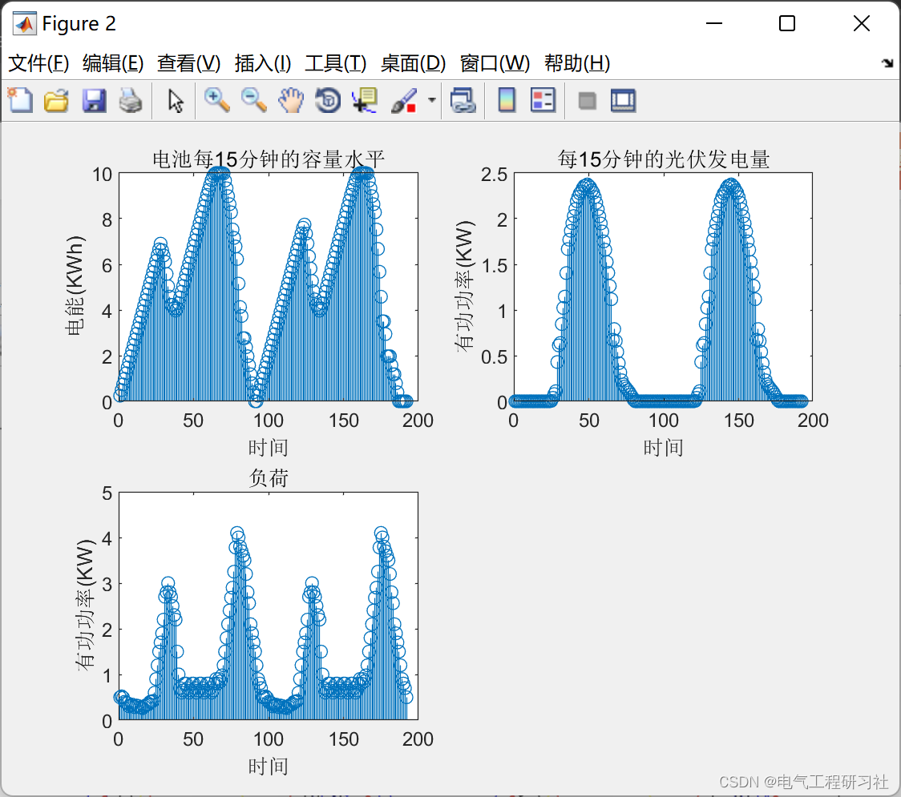
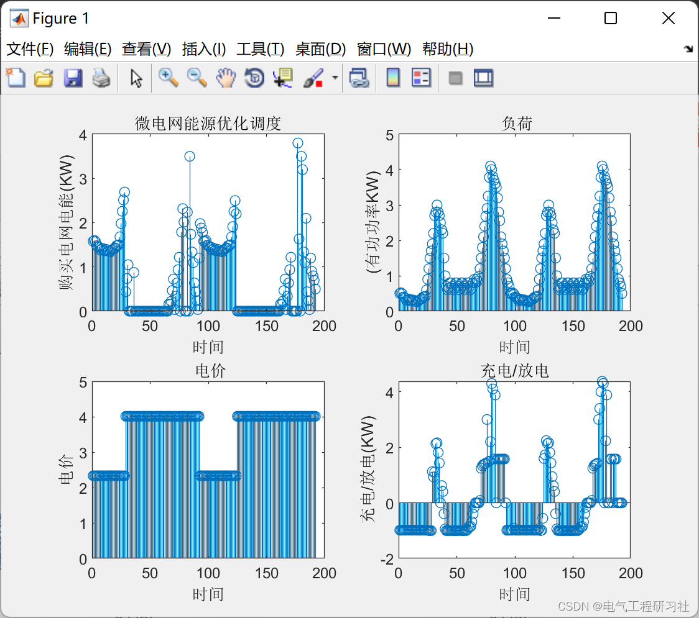
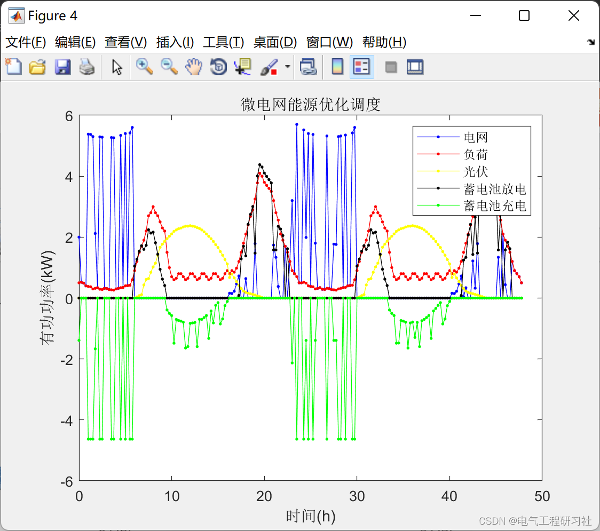
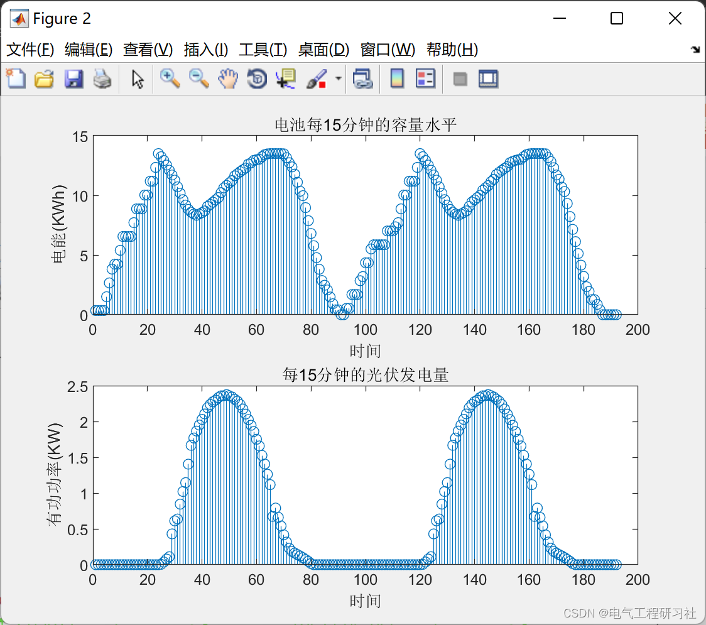
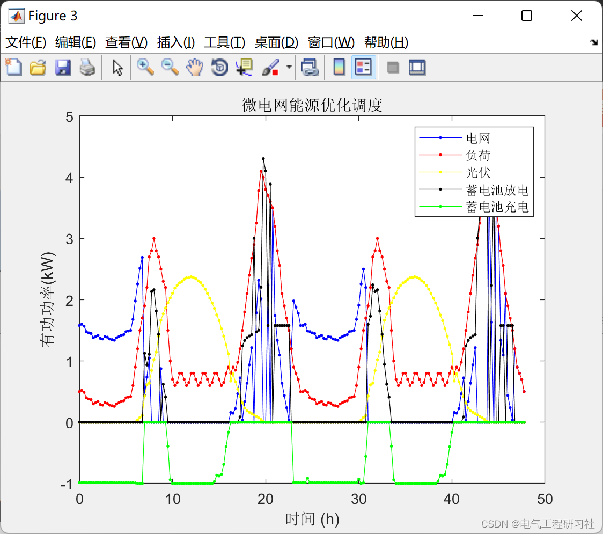
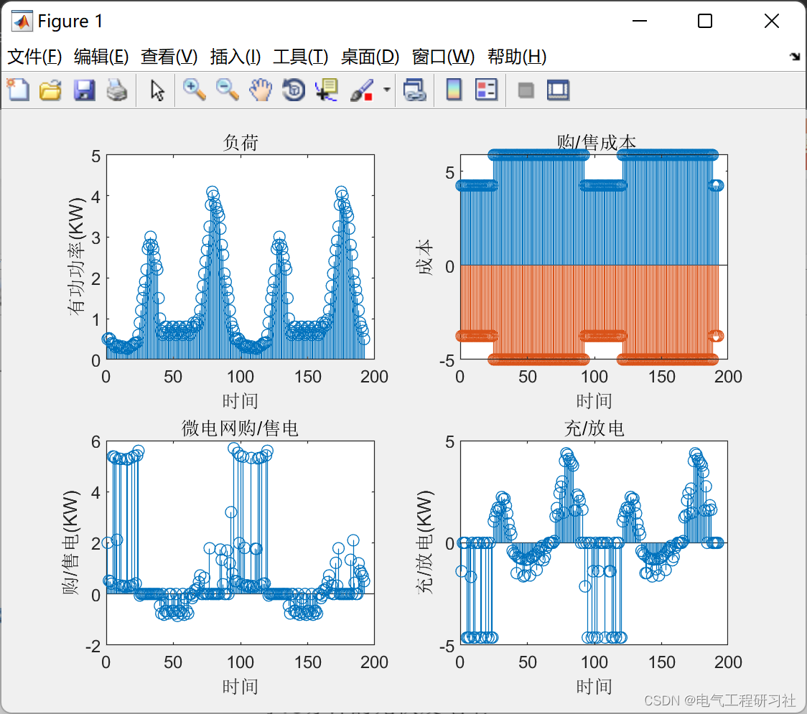
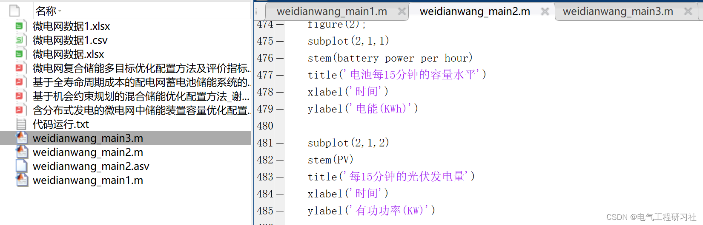

# Optimization of Energy Storage Capacity in Microgrids with Distributed Power Generation (Matlab Code Implementation)

​  
1. Overview With the development of economy, traditional energy is becoming increasingly scarce, and environmental pollution is becoming more severe. Countries have begun to turn their attention towards new clean energy sources.
The development of energy, the development of renewable energy power (REP) technology has become a solution to the problems brought by traditional energy.
The inevitable choice of [1-2]. Microgrid technology is an important form of effective utilization of distributed renewable energy, yet distributed generation has significant differences from traditional power sources. Its main characteristics lie in the randomness and intermittency of distributed generation outputs such as wind and solar power, which can greatly impact the safety and stability of microgrids. To ensure the system's safe and stable operation, energy storage devices have become an essential component of the microgrid system. Energy storage devices can be divided into power-type and energy-type. Power-type energy storage devices have fast response times, long cycle life, and rapid charging/discharging rates, generally used to smooth out the power output of distributed generation; energy-type energy storage devices have longer storage periods and larger storage capacities, suitable for peak shaving and valley filling of system loads. During grid-connected operation, the load's peak-valley difference and the volatility of distributed generation are often coexisting. A hybrid energy storage system is more conducive to the safe and stable operation of the microgrid system than a single energy storage device. The most crucial issue when adding energy storage devices to the microgrid is the capacity configuration of the storage devices. Based on the fluctuation characteristics of wind power power minute-level components, literature [8] determines the capacity configuration and maximum charging/discharging power of the energy storage system using interval estimation theory based on probability statistics, which can improve the smooth output of wind power by using smaller capacity energy storage equipment.
Due to the randomness and intermittency of distributed generation, microgrids incorporating distributed generation are challenging to meet grid connection requirements. By equipping suitable-capacity energy storage devices within the microgrid and implementing appropriate control methods, not only can the output power from distributed generation be smoothed, but it can also achieve the effect of peak shaving and valley filling for the microgrid load. The paper proposes a method that applies upper and lower bound constraints as well as weighted moving average control to meet the grid connection requirements of the microgrid, with the objective of minimizing the capacity of the energy storage device, and optimizes the capacity configuration of the hybrid energy storage device based on this premise. Simulation results show that the proposed method not only enables distributed generation output to meet the requirements of the microgrid but also achieves the optimization of energy storage capacity. To optimize the battery capacity within the microgrid, the objective function is to minimize the overall operational cost or maximize economic benefits during the configuration process, while the constraints include corresponding operational constraints and energy balance constraints, etc. Finally, the model is simplified into a mixed integer linear programming problem, which is solved efficiently using MATLAB.
2 Results 2.1 Example 1 Edit
Edit
Edit
2.2 Example 2 Edit
Edit
Edit
2.3 Example 3 Edit
Edit
3 Matlab Code and Article Reading This section only showcases part of the code, all codes and detailed articles can be found in:

## Images

<!-- PAYMENT_BLOCK -->

## Get this dataset

- Payment link (Stripe): [Buy now](https://buy.stripe.com/3cs8yP7sY87d0vu9AB)
- Payment QR code: 

<!-- /PAYMENT_BLOCK -->
